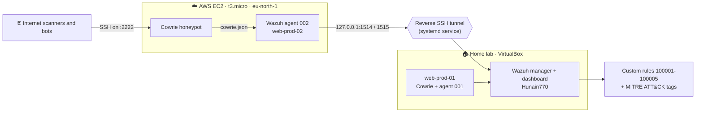
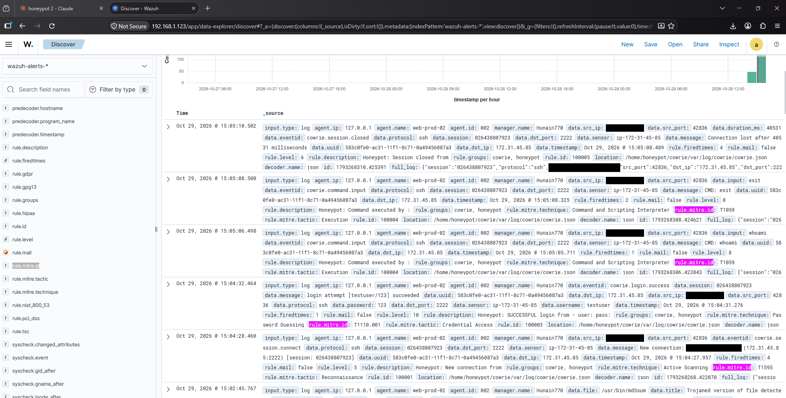
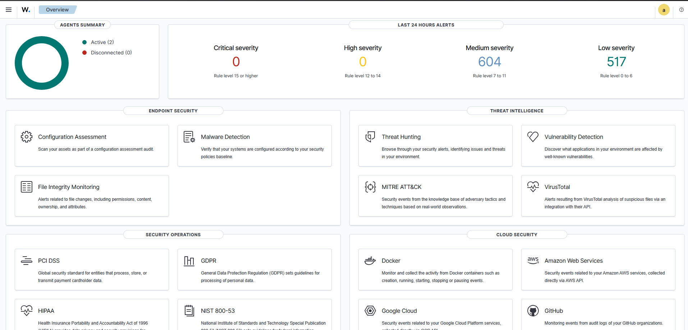
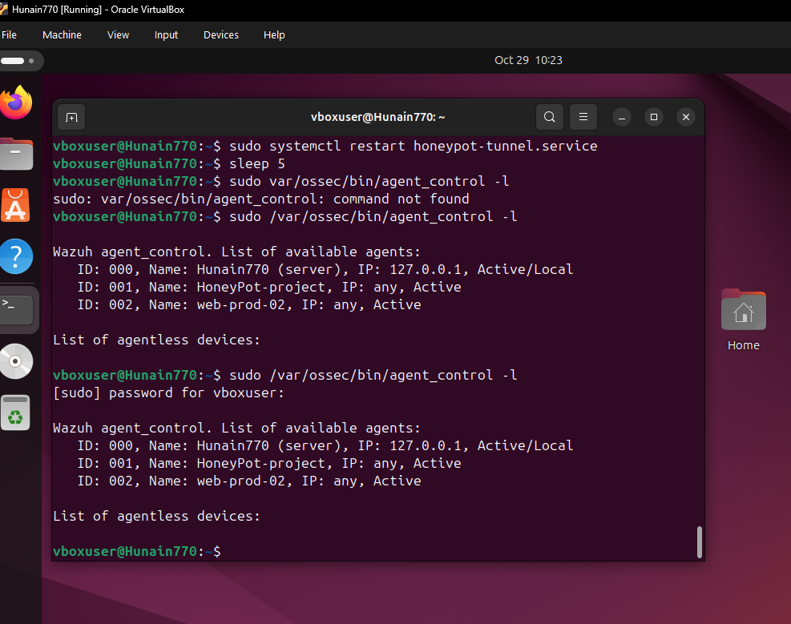
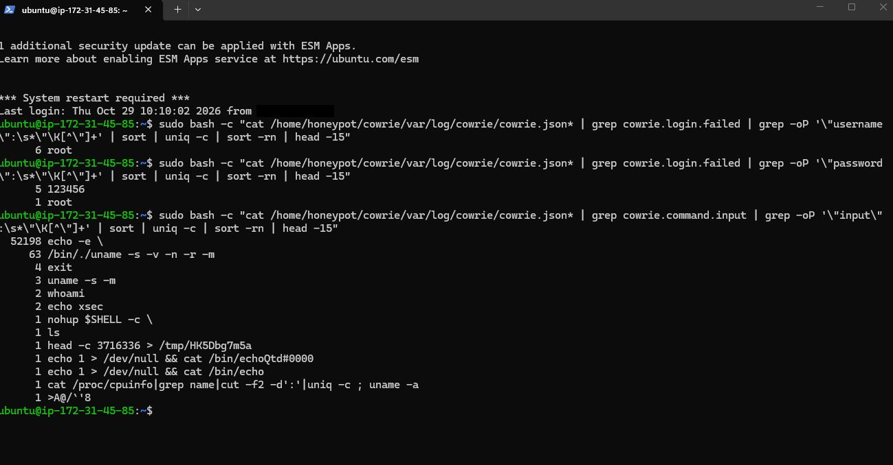
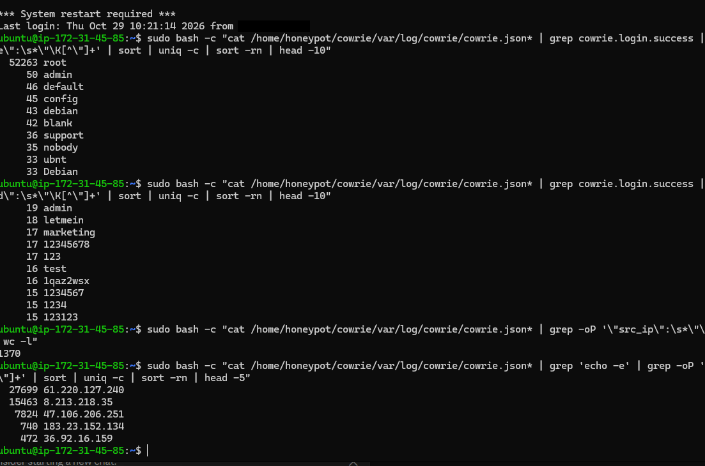

<div align="center">

# 🍯 Cowrie + Wazuh Honeypot

**An internet-facing SSH honeypot on AWS, feeding a home-lab Wazuh SIEM through a reverse SSH tunnel, with custom detection rules mapped to MITRE ATT&CK.**


</div>

---

## 📌 At a glance

I deployed a [Cowrie](https://github.com/cowrie/cowrie) SSH honeypot on a free-tier AWS EC2 instance, shipped its logs into a Wazuh SIEM running on VirtualBox VMs at home, and wrote my own decoder-based rules and MITRE ATT&CK tags to detect what hit it. It ran from **Sep 9 to Oct 29, 2026**.

| Total events | Login-related events | Unique source IPs | Files dropped on the box |
|:---:|:---:|:---:|:---:|
| **~427,630** | **~53,377** | **~1,370** | **0** |

The most interesting finding: **three IPs produced about 95% of all traffic**, and almost every successful login was `root`, followed by the same automated command.

---

## 📑 Contents

- [Architecture](#-architecture)
- [Detection rules and MITRE mapping](#-detection-rules-and-mitre-attck-mapping)
- [What the honeypot caught](#-what-the-honeypot-caught)
- [How I built it](#-how-i-built-it)
- [Problems I hit and how I fixed them](#-problems-i-hit-and-how-i-fixed-them)
- [Limitations](#-limitations-and-honest-caveats)
- [What I would do next](#-what-i-would-do-next)
- [Repo layout](#-repo-layout)

---

## 🏗 Architecture



**Two honeypots, one SIEM**

| Component | Where | Role |
|---|---|---|
| `web-prod-01` | Local VirtualBox VM | Test honeypot. I built and debugged the detection rules here. Never exposed to the internet. |
| `web-prod-02` | AWS EC2 (Ubuntu 26.04, t3.micro, Stockholm) | Public honeypot. Cowrie listens on port 2222. |
| `Hunain770` | Local VirtualBox VM | Wazuh manager and dashboard (v4.9.2). |

**Why a reverse SSH tunnel?** The EC2 agent has to reach the Wazuh manager at home, but my ISP router (a ZTE/PTCL model) had no port-forwarding page I could find. Instead, the manager VM opens an outbound SSH connection to EC2 with `-R 1514:localhost:1514 -R 1515:localhost:1515`. The EC2 agent then talks to `127.0.0.1`, and the traffic comes out at the manager. No inbound ports on my home network, and the tunnel runs as a systemd service that restarts itself (`configs/honeypot-tunnel.service`).

**Network exposure on AWS**

- Port **2222** (the honeypot): open to the world on purpose.
- Port **22** (real SSH): restricted to my own IP only.

---

## 🛡 Detection rules and MITRE ATT&CK mapping

Custom rules live in [`configs/local_rules.xml`](configs/local_rules.xml). They match Cowrie's JSON events on the `eventid` field and add MITRE technique tags, so every alert shows up in the Wazuh dashboard with its ATT&CK tactic and technique.

| Rule ID | Level | Cowrie event | What it means | MITRE technique |
|:---:|:---:|---|---|---|
| 100001 | 5 | `cowrie.session.connect` | New connection | **T1595** Active Scanning (Reconnaissance) |
| 100002 | 7 | `cowrie.login.failed` | Failed login attempt | **T1110** Brute Force (Credential Access) |
| 100003 | 10 | `cowrie.login.success` | Successful login | **T1110.001** Password Guessing (Credential Access) |
| 100004 | 8 | `cowrie.command.input` | Command run in the fake shell | **T1059** Command and Scripting Interpreter (Execution) |
| 100005 | 6 | `cowrie.session.closed` | Session closed | none (bookkeeping) |

Example rule:

```xml
<rule id="100002" level="7">
  <decoded_as>json</decoded_as>
  <field name="eventid">cowrie.login.failed</field>
  <description>Honeypot: Failed login attempt from $(data.src_ip) - user: $(data.username)</description>
  <mitre>
    <id>T1110</id>
  </mitre>
</rule>
```

**Rules firing with MITRE fields in the dashboard** (these are my own test connections):



---

## 📊 What the honeypot caught

All numbers below come from the raw Cowrie logs on the EC2 box (including the rotated daily files), not from Wazuh alerts, because the tunnel was down at times and the dashboard may undercount.

### Traffic is concentrated in a few sources

| Source IP | Total events |
|---|---:|
| 61.220.127.240 | 221,600 |
| 8.213.218.35 | 123,712 |
| 47.106.206.251 | 62,635 |
| 183.23.152.134 | 5,931 |
| 36.92.16.159 | 3,814 |

The top three account for roughly 95% of the ~427,630 events, with a long tail of IPs that connected only a handful of times. These are the addresses the honeypot saw. They may be compromised machines or rented servers rather than the real operator.

### Almost every login was `root`

Of roughly 53,000 successful logins, **52,263 used the username `root`**. The next most common usernames (`admin`, `default`, `config`, `debian`, `support`, `ubnt`) appear only 33 to 50 times each. The passwords were spread thin: the most common, `admin`, appears 19 times.

### One command dominated

| Command run after login | Count |
|---|---:|
| `echo -e \` | 52,198 |
| `/bin/./uname -s -v -n -r -m` | 63 |
| `exit` | 4 |
| `uname -s -m` | 3 |
| `whoami`, `echo xsec` | 2 each |

The `echo -e` command came almost entirely from five IPs (27,699 from `61.220.127.240`, 15,463 from `8.213.218.35`, 7,824 from `47.106.206.251`, then 740 and 472). Together with the `uname` and `/proc/cpuinfo` fingerprinting commands, this looks like a scripted routine that logs in, profiles the system and tries to write data through the shell. Cowrie only recorded the start of that command, so I can't say what the script was trying to do next.

### Nothing was dropped on the box

The downloads folder was empty, so no bot managed to upload a file. 11 session recordings were captured.

### Dashboard and agent status

| | |
|---|---|
|  |  |





---

## 🔧 How I built it

<details>
<summary><b>1. Local lab: Wazuh manager and test honeypot</b></summary>

- Two Ubuntu VMs in VirtualBox: `Hunain770` (Wazuh manager and dashboard) and `web-prod-01` (Cowrie plus a Wazuh agent).
- Cowrie runs as an unprivileged `honeypot` user inside a Python virtual environment.
- The Wazuh agent on `web-prod-01` watches Cowrie's JSON log:

```xml
<localfile>
  <log_format>json</log_format>
  <location>/home/honeypot/cowrie/var/log/cowrie/cowrie.json</location>
</localfile>
```
</details>

<details>
<summary><b>2. AWS: EC2 instance and security group</b></summary>

- Free-tier account with a zero-spend budget alert and free-tier usage alerts turned on before launching anything.
- `t3.micro`, Ubuntu 26.04 LTS, region `eu-north-1`, 8 GiB disk.
- Security group: SSH (22) from my IP only, custom TCP 2222 from `0.0.0.0/0`.
</details>

<details>
<summary><b>3. Installing Cowrie on the EC2 instance</b></summary>

```bash
sudo apt update && sudo apt install -y git python3-venv python3-dev libssl-dev libffi-dev build-essential
sudo adduser --disabled-password honeypot && sudo su - honeypot

git clone https://github.com/cowrie/cowrie.git && cd cowrie
python3 -m venv cowrie-env && source cowrie-env/bin/activate
pip install --upgrade pip
pip install -r requirements.txt
pip install --editable .          # newer Cowrie needs this to get the `cowrie` command

cp src/cowrie/data/etc/cowrie.cfg.dist etc/cowrie.cfg
cp src/cowrie/data/etc/userdb.example etc/userdb.txt
cowrie start
```

`listen_endpoints` is `tcp:2222:interface=0.0.0.0`, which matches the open port in the security group.
</details>

<details>
<summary><b>4. Wazuh agent on EC2, pointed at the tunnel</b></summary>

```bash
curl -so wazuh-agent.deb https://packages.wazuh.com/4.x/apt/pool/main/w/wazuh-agent/wazuh-agent_4.9.2-1_amd64.deb
sudo dpkg -i wazuh-agent.deb
```

In `/var/ossec/etc/ossec.conf` on the agent, the manager address is `127.0.0.1` (the tunnel endpoint), and the same `<localfile>` block as above points at Cowrie's JSON log.

On the manager (`sudo /var/ossec/bin/manage_agents`): add agent `web-prod-02` with IP `any`, extract its key, then import the key on the agent with `manage_agents` (option `I`) and restart `wazuh-agent`.
</details>

<details>
<summary><b>5. The reverse SSH tunnel as a systemd service</b></summary>

Runs on the manager VM. The full unit file, with host and key path redacted, is in [`configs/honeypot-tunnel.service`](configs/honeypot-tunnel.service). The important parts:

```ini
ExecStart=/usr/bin/ssh -i <PATH_TO_TUNNEL_KEY> \
  -R 1514:localhost:1514 -R 1515:localhost:1515 -N \
  -o ServerAliveInterval=30 -o ServerAliveCountMax=3 \
  ubuntu@<EC2_PUBLIC_IP>
Restart=always
RestartSec=10
```

`ServerAliveInterval` catches silently dead connections, and `Restart=always` brings the tunnel back after a drop or a reboot.
</details>

<details>
<summary><b>6. Writing and testing the rules</b></summary>

- Added the rules to `/var/ossec/etc/rules/local_rules.xml`.
- Tested each change with `wazuh-logtest`, pasting a real Cowrie JSON line to see which decoder and rule matched.
- Added `<mitre>` blocks, restarted the manager, and confirmed `rule.mitre.id`, `rule.mitre.tactic` and `rule.mitre.technique` appeared on live events in Discover.
</details>

---

## 🐛 Problems I hit and how I fixed them

<details>
<summary><b>Show the troubleshooting log</b></summary>

| Problem | Cause | Fix |
|---|---|---|
| My rules never fired | They used `decoded_as` `cowrie-json`, but `wazuh-logtest` showed the real decoder name is `json` | Changed every rule to `<decoded_as>json</decoded_as>` and re-tested |
| SSH key auth failed even though the key was "added" | A long public key got corrupted when pasted between VMs; the fingerprints didn't match | Compared fingerprints with `ssh-keygen -lf`, then moved the key as a file instead of retyping it |
| `bin/cowrie` did not exist | Newer Cowrie moved its config templates and installs the command through pip | `pip install --editable .`, and copied the config from `src/cowrie/data/etc/` |
| SSH to EC2 suddenly timed out | My home IP changed and the security group only allowed the old one | Updated the port 22 rule to the new IP |
| Tunnel looked "active" but agents were disconnected | Old SSH sessions on EC2 still held ports 1514/1515, so the new forward failed ("remote port forwarding failed") | Cleared the stale sessions and let systemd restart the service |
| My first data count looked tiny (5 events) | I only read the current log file, and Cowrie rotates its logs daily | Counted across all `cowrie.json*` files |

</details>

---

## ⚠️ Limitations and honest caveats

- **Successful logins are not password guessing.** Cowrie accepts most `root` passwords by default, so the ~53,000 "successful logins" mostly measure bots reaching the fake shell. Because of that, tagging rule 100003 as T1110.001 is debatable, and T1078 (Valid Accounts) would fit better. Only 6 logins were ever rejected.
- **Small number of sources.** A few hosts generated nearly all the traffic over a single region and a single IP address, so this is not a representative picture of internet-wide scanning.
- **The tunnel is a trust risk.** It gives an internet-facing machine a path back to the SIEM. It is bound to localhost and uses a dedicated key, but a real deployment would put the manager on a separate network and restrict that key's permissions.
- **Host key checking was turned off** for the tunnel (`StrictHostKeyChecking=no`) to keep the service from stalling on a prompt. A hardened version should pin the EC2 host key.
- **The tunnel broke twice** when my home IP changed, because the SSH rule was locked to one address. An Elastic IP and a dynamic allow-list would avoid this.
- **The dashboard may undercount.** The tunnel was down at times, so some events may have reached the raw logs without reaching Wazuh (I didn't measure the gap), which is why all statistics come from the raw logs.
- **One unexplained alert:** Wazuh flagged `/usr/bin/md5sum` on the EC2 box as a "trojaned" file. I did not investigate it, so I can't say whether it was a false positive.

---

## 🚀 What I would do next

- Enrich source IPs with a reputation service such as AbuseIPDB.
- Add correlation rules (for example, many failed logins from one IP within 60 seconds).
- Build a dedicated Wazuh dashboard: top sources, events over time, MITRE coverage.
- Tighten Cowrie's `userdb` so common passwords are rejected, producing real brute-force data.
- Use an Elastic IP and pin the host key for the tunnel.

---

## 🗂 Repo layout

```
.
├── README.md
├── LICENSE
├── configs/
│   ├── local_rules.xml            # custom Wazuh rules with MITRE tags
│   └── honeypot-tunnel.service    # reverse SSH tunnel (redacted)
└── screenshots/                   # dashboard and AWS screenshots (sensitive details blacked out)
```

Raw logs, SSH keys and session recordings are deliberately not included.

---

<div align="center">

Built by [Hunain](https://github.com/Hunain-Amin) as a hands-on cybersecurity project.

</div>
